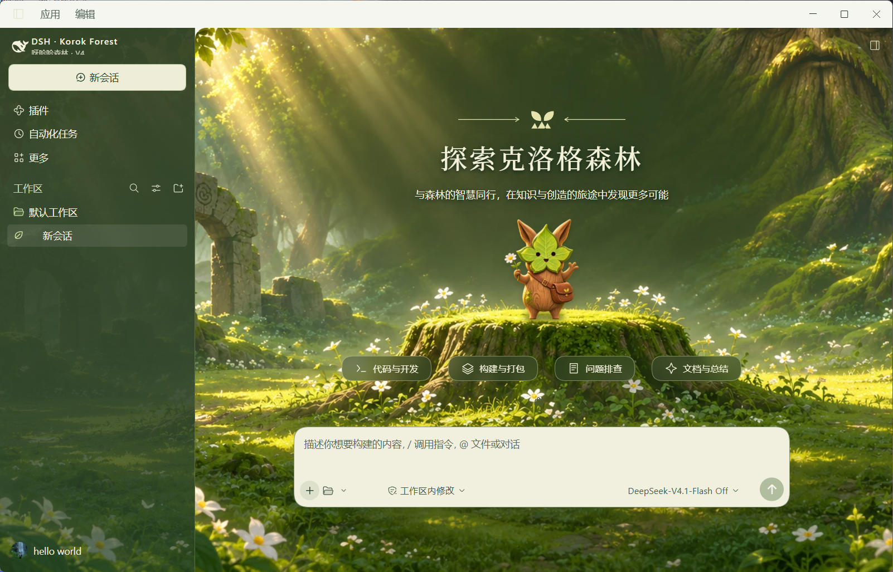
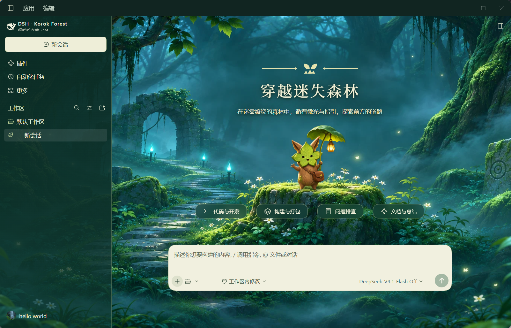
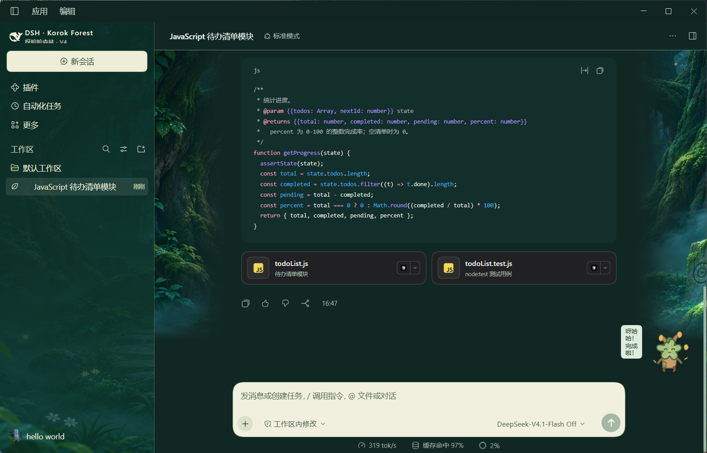
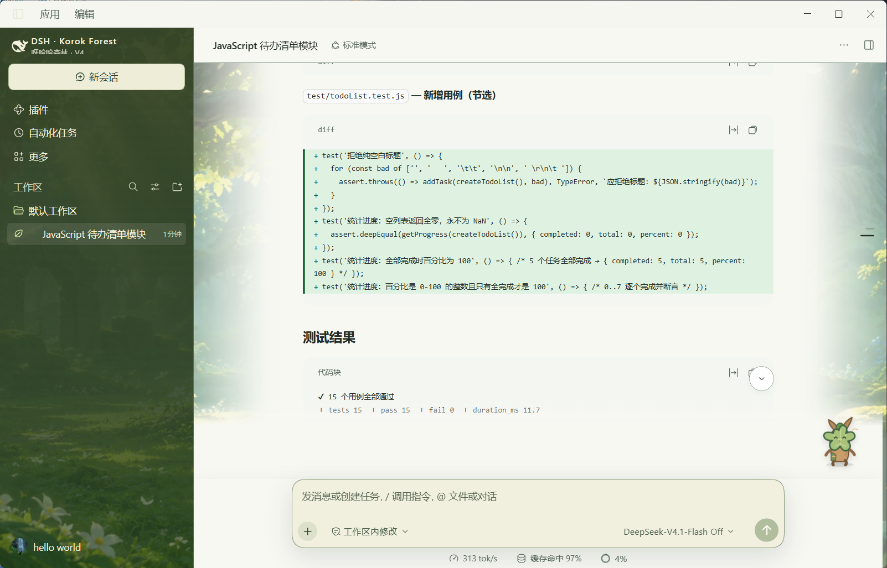
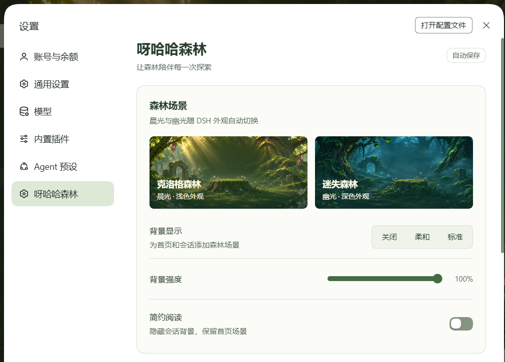
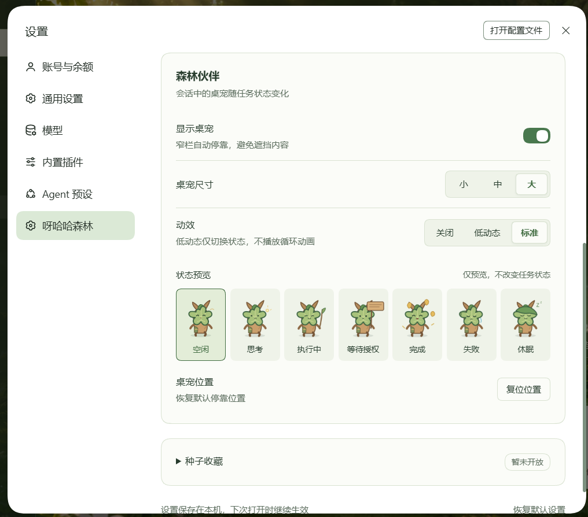

# Korok Forest · 呀哈哈森林

让森林陪伴每一次探索。

为 **DeepSeek Harness（DSH）** 制作的森林主题与桌宠插件。晨光中的克洛格森林、幽光中的迷失森林，随浅色与深色外观切换。写代码、查看修改、等待任务完成时，森林伙伴陪你一起工作。



## 功能

- **晨光 / 幽光双主题** — 跟随 DSH 的浅色、深色或系统外观，覆盖首页、侧栏、会话和输入区。
- **适合阅读的会话背景** — 森林在两侧渐隐，正文保留实色底；代码与 Diff 沿用宿主的语法高亮。
- **四个任务入口** — 代码与开发、构建与打包、问题排查、文档与总结。点击填入提示词，由你补充内容并发送。
- **七态森林伙伴** — 空闲、思考、执行中、等待授权、完成、失败、休眠，跟随当前会话的任务状态变化。
- **可调节的陪伴方式** — 桌宠支持显示开关、三档尺寸、动效和位置复位；窄栏自动停靠，避免遮挡附件。
- **独立的森林设置页** — 背景开关、强度调节、简约阅读和桌宠状态预览，修改自动保存在本机。

## 实机展示

以下为 Windows 桌面版 DSH 的实机截图，使用 V4 设计实现。

### 幽光首页

深色外观下，森林伙伴提灯等候，输入区保持柔和的浅色底。



### 代码与任务结果

深色会话中的 JavaScript 代码块、生成文件卡片与任务完成状态。



浅色会话中的 Diff 片段与演示任务测试结果。图中的 15 项测试属于演示待办清单项目。



### 森林设置

场景强度与简约阅读，可按自己的阅读习惯调整。



桌宠尺寸、动效与七种状态预览。预览只影响设置页，不会改变实际任务状态。



## 快速安装

### 使用预构建安装包（普通用户推荐）

需要先安装并启动过 DSH 桌面版。本项目已在 **Windows + DSH 0.2.2-rc.3** 上进行实机验收。

1. 从 [GitHub Releases](https://github.com/Rany010/dsh-korok-forest/releases) 下载 `dsh-korok-forest-0.1.0.tgz`，**无需解压**。如果 Releases 尚无安装包，请使用下方源码安装方式。
2. 通过 DSH 的 **应用 → 退出** 完全退出程序，避免只关闭窗口后仍驻留托盘。在 PowerShell 中执行以下命令，将 DSH 安装路径和安装包路径替换为自己的实际位置。

```powershell
& 'E:\DSH\resources\runtime\cli\bin\dsh.cmd' plugin --profile desktop add 'C:\Users\你的用户名\Downloads\dsh-korok-forest-0.1.0.tgz'
```

3. 重新启动 DSH，进入 **设置 → 呀哈哈森林**。新建会话即可看到森林首页。

此方式使用 DSH 自带的运行时和包管理器，用户无需另装 Node.js、npm 或 Git，也无需编译项目。桌面版使用 `desktop` profile。

### 从源码安装（开发者）

需要 Git、Node.js 22 或更新版本，以及 DSH 桌面版。先启动过 DSH 一次，再通过 **应用 → 退出** 完全退出程序。

```powershell
git clone https://github.com/Rany010/dsh-korok-forest.git
cd dsh-korok-forest
npm ci
npm run build

& 'E:\DSH\resources\runtime\cli\bin\dsh.cmd' plugin --profile desktop add "$((Get-Location).Path)"
```

重新打开或刷新 DSH。之后修改源码时，先执行 `npm run build`，再刷新客户端。

包中声明的 DSH 兼容范围为 `>=0.2.2-rc.1 <0.3.0`，其中桌面版 `0.2.2-rc.3` 已实机验证。其他版本或平台的界面布局仍需验证。

## 使用方式

### 切换主题

在 DSH **设置 → 通用设置** 中切换浅色、深色或跟随系统外观。森林主题自动切换，无需在插件中重复选择。

### 调整背景和桌宠

打开 **设置 → 呀哈哈森林**。

| 设置 | 效果 |
| --- | --- |
| 背景显示 | 关闭、柔和、标准；柔和为 28%，标准为 88% |
| 背景强度 | 支持 0–100% 调节，默认 88% |
| 简约阅读 | 隐藏会话背景，保留首页场景 |
| 显示桌宠 | 独立控制首页角色与会话桌宠的显示 |
| 桌宠尺寸 | 小、中、大，作用于会话桌宠 |
| 动效 | 关闭、低动态、标准；低动态只切换状态，不播放循环动画 |
| 状态预览 | 查看七种状态的造型，不触发任务或授权 |
| 复位位置 | 恢复桌宠默认位置；窄栏使用独立停靠区域 |
| 恢复默认设置 | 二次确认后重置本机的插件偏好 |

宽栏中的会话桌宠可拖动。开启系统减少动态效果时，循环动画也会停用。设置保存在当前客户端的本地存储中，不跨设备同步。

### 当前范围

- 桌宠使用七张状态素材，配合轻量 CSS 动效，并非逐帧角色动画。
- 等待授权的状态提示由宿主任务状态驱动，实际授权仍在 DSH 原有界面处理。
- 种子自动收集与徽章解锁暂未开放，设置页仅展示规划中的收藏项目。
- 本插件提供主题和桌宠展示，代码生成、文件编辑、工具执行与模型能力由 DSH 提供。

## 卸载

先通过 **应用 → 退出** 完全退出 DSH，再执行下列命令。

```powershell
& 'E:\DSH\resources\runtime\cli\bin\dsh.cmd' plugin --profile desktop remove dsh-korok-forest
```

重新打开或刷新 DSH，恢复宿主原有外观。卸载保留本机偏好，便于重新安装后继续使用；如需重置，请在卸载前使用 **设置 → 呀哈哈森林 → 恢复默认设置**。

## 开发与打包

```powershell
npm ci
npm test
npm run build
New-Item -ItemType Directory -Force dist | Out-Null
npm pack --pack-destination dist
```

生成的 `.tgz` 包包含预构建客户端，可作为 GitHub Release 附件分发。发布时先完成构建再打包，确保安装包中的 `lib/client.js` 与源码一致。

客户端通过 DSH 的主题 Token 和插槽扩展界面。源码主要位于 `src/client/`，桌宠状态机位于 `src/pet/`，设置模型位于 `src/settings/`。

## 展示素材

实机截图位于 [`docs/screenshots/release/`](docs/screenshots/release/)，保留提供素材的原始清晰度，可用于 README 和后续产品介绍。

| 文件 | 内容 | 建议用途 |
| --- | --- | --- |
| `home-light.png` | 晨光首页 | 产品首图 |
| `home-dark.png` | 幽光首页 | 双主题对比 |
| `session-code-dark.png` | 深色代码会话与完成状态 | 展示实际工作场景 |
| `session-diff-light.png` | 浅色 Diff 与测试结果 | 展示修改与验证流程 |
| `settings-scene.png` | 森林场景设置 | 介绍背景与阅读选项 |
| `settings-companion.png` | 桌宠设置及七态预览 | 介绍桌宠与个性化选项 |

X 帖子可优先选用两张首页、代码会话和桌宠设置，共四张图片。
